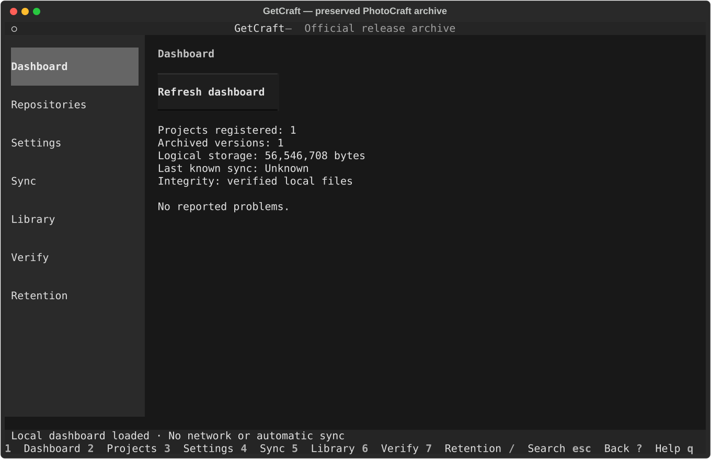
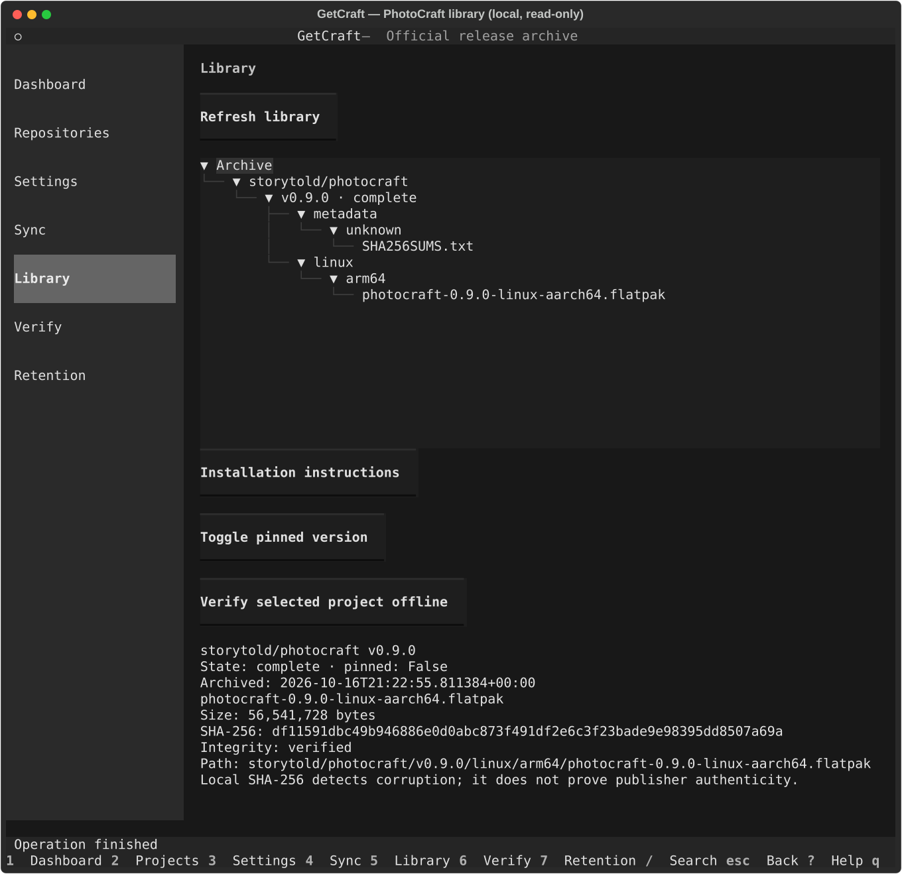

# M3.6 validation — interactive terminal

Validated on 2026-10-16, Python 3.14.7, Textual 8.2.8, Fedora Linux.
M0–M3.5 started at a clean, synchronized `main`. M4 was not started.

## Delivered increments

1. M3.6.1: Textual shell, seven pages, sidebar, shortcut footer, dark theme, help,
   scrollable compact-terminal layouts and an actual local dashboard.
2. M3.6.2: shared configuration/registry adapters, search/add/enable/disable/remove,
   validated global/project forms, reviewed detection and inheritance, explicit TOML
   repair, library hierarchy, installation guidance and pin management.
3. M3.6.3: threaded discovery/planning/download/verification/retention, preview and
   confirmation, per-file bytes, overall processed-file counts, file outcomes,
   cooperative cancellation, offline integrity and existing audited safe pruning.

Start with `getcraft` or `getcraft --config PATH`. CLI `--help` and all commands remain
available. Install/update dependencies with `python -m pip install -e '.[dev]'` inside
an activated project virtual environment.

## Automated checks

- `pytest -q`: **187 passed**, including **all 160 existing tests** and 27 additional cases.
- `ruff check .`: passed.
- `ruff format --check .`: passed.
- `git diff --check`: passed.
- `python -m pip check`: no broken requirements.
- No static type checker is configured. CI retains its Python 3.12/3.13/3.14 matrix;
  local execution used 3.14. Native Windows/macOS terminal integration was not exercised.

New tests cover CLI/TUI entry compatibility, keyboard navigation/help and small terminals,
empty/offline startup, forms and persistence, cancel without saving, platform/format/CPU
selection, reviewed host suggestions, inheritance, repair of invalid TOML, project add/search/
disable/removal confirmation, library/file details/guidance/pins, recoverable sanitized
network errors, explicit sync confirmation/cancellation, read-only retention previews,
confirmed pruning exclusively in temporary fixtures, stale configuration/archive rejection,
pins changed while waiting for the prune lock, archive-path changes preserving original
backups, API errors without archive writes, interrupted streaming cleanup, preservation
of originals, partial journaling and per-file/reused progress events.

All HTTP unit tests are mocked. Every destructive test uses pytest temporary directories.
No real installer was downloaded, executed or removed during M3.6 validation.
The actual `getcraft --config /tmp/getcraft-m2-demo.toml` entry point was also opened
in a PTY and closed with `q`, returning exit code 0 and restoring the terminal.

## PhotoCraft read-only demonstration

The existing, previously authorized M2 archive `/tmp/getcraft-m2-demo` was inspected by
the running TUI with `/tmp/getcraft-m2-demo.toml`. This preserves one Linux ARM64 Flatpak
release, not the current host's automatically applied preferences. Detection never changed it.

Observed dashboard/library:

- Registered projects: 1 (`storytold/photocraft`).
- Archived versions: 1 (`v0.9.0`), verified complete.
- Logical archive storage: **56,546,708 bytes**, including local metadata.
- Last synchronization: **Unknown**; the M2 demo predates persisted sync history.
- Installer: `photocraft-0.9.0-linux-aarch64.flatpak`, **56,541,728 bytes**.
- Local SHA-256: `df11591dbc49b946886e0d0abc873f491df2e6c3f23bade9e98395dd8507a69a`.
- Verification document: `SHA256SUMS.txt`, **2,589 bytes**.

The same preview adapter used by the TUI queried the official GitHub Releases API:

```text
storytold/photocraft v0.9.0
SELECTED photocraft-0.9.0-linux-aarch64.flatpak (56,541,728 bytes)
SELECTED SHA256SUMS.txt (2,589 bytes)
Estimated download: 0 bytes; reusable: 56,544,317 bytes; 1 releases.
```

It displayed the other 24 assets as ignored with explicit platform, architecture,
format or auxiliary-metadata reasons. No ambiguous assets were present in this upstream
release. The preview did not download anything or rewrite manifests/inventory.

Screenshots exported from a headless Textual/Pilot session of that actual local archive:





These are terminal SVG captures, not mockups. Exported external font declarations were
removed so the captures use locally available monospace fonts without CDN requests. No installer or runtime inventory is committed.

## Retention demonstration

A separate synthetic temporary archive held four complete stable versions, each containing
three platform-specific installers. Both CLI `prune --repo storytold/photocraft --dry-run`
and the TUI preview/confirmation flow selected only `v1.0`, preserving `v2.0`–`v4.0`.
The dry-run preserved every file. Its summary was:

```text
Would remove storytold/photocraft v1.0: 14624 bytes
Keep storytold/photocraft v4.0: verified retention window
Keep storytold/photocraft v3.0: verified retention window
Keep storytold/photocraft v2.0: verified retention window
Candidates: 1 releases; 14624 bytes
Simulation only; no archive changes.
```
 Confirmed deletion was exercised only by temporary tests.
No `prune --apply` was run against the real preserved PhotoCraft archive.

## Limits and M4 handoff

- UI labels currently use English. Keyboard operation and compact layouts are tested;
  90×30 or larger is recommended, and long panels/forms require scrolling.
- Cancellation is cooperative at stream boundaries and before publication; current network
  reads may delay acknowledgement. No unsafe thread termination or Range resume was added.
- Read-only queries/verification finish before normal exit; physical pruning cannot be
  cancelled once confirmed, preserving the existing audit/revalidation behavior.
- Large archives require full local hashing; this runs outside the UI thread but can take time.
  The dashboard can be refreshed explicitly; it does not pretend to have live remote data.
- CLI remains the interface for report export, inventory reconstruction and advanced options.
  TUI installation guidance is generated from preserved metadata without executing commands.
- Trust model, signature-authentication limits and offline-installation caveats from M2/M3
  remain unchanged. Preserving installers does not preserve all external dependencies.
- M4 still needs optional, explicitly enabled user scheduling and further cross-platform,
  interruption/large-archive integration hardening. No timer/service was installed or enabled.
